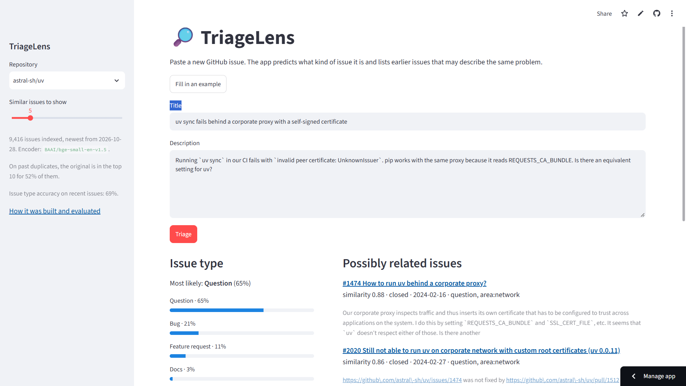

**[Russian Version / На русском](README.ru.md)**

# TriageLens

[](https://www.python.org/)
[](https://streamlit.io/)
[](https://github.com/IlyaShaposhnikov/triage-lens/actions)
[](LICENSE)
[](https://triage-lens.streamlit.app/)
[](https://huggingface.co/datasets/IlyaShaposhnikov/triage-lens-demo)

Triage for GitHub issues: **what kind of issue is this, and has it been reported before?**
Built and evaluated on live issues from two popular Python projects,
[astral-sh/uv](https://github.com/astral-sh/uv) and [pandas-dev/pandas](https://github.com/pandas-dev/pandas).

**[Try the demo →](https://triage-lens.streamlit.app/)** Paste an issue and get its likely type
plus earlier issues that may describe the same problem.



## Key findings

- **Semantic search finds duplicates far better than keywords.** For an issue later closed as a
  duplicate, the original is among the top 10 results for **52% (uv) and 58% (pandas)** of
  them with `bge-small` embeddings, against 27% and 33% for BM25.
- **One text representation does not fit both tasks.** The same MiniLM embeddings that lose
  to TF-IDF at predicting the issue type beat keyword search at finding duplicates by
  17–18 pp: they capture *what an issue is about*, not *what the author wants*.
- **A retrieval-trained encoder of the same size is worth it.** `bge-small` beats MiniLM by
  +7.4 pp (uv) and +7.6 pp (pandas) recall@10 on the same queries, at about three times the
  encoding cost on a CPU.
- **Issue forms already do most of the type classification.** Authors pick the right form 82%
  (uv) and 92% (pandas) of the time. No model beats that, and none flags misfiled issues
  reliably. Where models help is issues filed **without** a form: +42 pp (uv) and +34 pp
  (pandas) accuracy over the fallback.
- **Fine-tuning buys a few points; zero-shot does not work here.** Fine-tuned DistilBERT is
  the best classifier, 2–4 pp above TF-IDF with overlapping intervals, but needs a GPU.
  Zero-shot BART-MNLI falls below the majority class on pandas.

## What is in the project

| Step | Module | What it does |
|---|---|---|
| Collect | `collect.py` | Downloads all issues through the GitHub GraphQL API with resumable cursors and rate-limit handling |
| Duplicate pairs | `duplicates.py` | Extracts "duplicate → original" pairs from comments and timeline events |
| Manual review | `review.py` | Measures the precision of those pairs on a stratified sample, on a local review page |
| Dataset | `dataset.py` | Maps labels to four classes, removes issue-form traces, splits by time |
| Evaluation | `evaluate.py` | Shared metrics with bootstrap intervals, plus the "form + flag" view |
| Classifiers | `baselines.py`, `embeddings.py`, `transformer.py` | Majority and trust-the-form baselines, TF-IDF, sentence embeddings, fine-tuned DistilBERT and zero-shot BART (on a Kaggle GPU) |
| Search | `search.py` | BM25, exact dense search, a Chroma vector database and hybrid fusion |
| Demo | `demo_data.py`, `refresh.py`, `app_core.py`, `app/` | Publishes the index to Hugging Face, keeps it up to date and serves it in Streamlit |
| Report | `report.py` | Builds the result tables below from `results/` |

## Data

Issues were collected on 29 October 2026: **9,416** from uv and **28,656** from pandas
(pull requests excluded).

**Labels.** Each project's labels are mapped to four classes:

| Class | uv | pandas |
|---|---|---|
| bug | `bug` | `Bug` |
| feature | `enhancement` | `Enhancement` |
| question | `question` | `Usage Question` |
| docs | `documentation` | `Docs` |

The target is the maintainer's final label. Issues with none or several of the four classes,
bot authors, and pandas issues still marked `Needs Triage` (their label only repeats the form
default) are left out. This keeps 6,412 uv and 15,509 pandas issues.

**Label leakage through issue forms.** Both projects use issue forms that set the label
automatically and leave traces in the text: title prefixes such as `BUG:`, section headings,
checkboxes, version dumps. A model trained on raw text would read the label off the template.
All such traces are removed (`dataset.clean_body`), and the form the author picked is kept in
a separate column that is never a model input.

**Time-based split.** Within each repository, the oldest 70% of issues are used for training,
the next 15% for validation, and the newest 15% for testing. The test sets (963 uv issues from
Dec 2025 to Oct 2026, 2,327 pandas issues from Jun 2023 to Oct 2026) lie entirely in the
issue-form era, which is how a model would be used.

**Misfiled issues.** Among issues filed through a form, the maintainer's final label differs
from the chosen form for 18% of uv issues and 8% of pandas issues. The most common error is a
usage question filed as a bug (419 cases in uv).

## Issue type classification

Every model returns class probabilities and is scored by the same code on the same test
split. Intervals are bootstrap 95% intervals.

| Model | uv accuracy | pandas accuracy | uv macro-F1 | pandas macro-F1 |
|---|---|---|---|---|
| Trust the issue form (baseline) | **77.5%** [74.9–80.1] | **91.5%** [90.3–92.6] | 0.574 | 0.786 |
| TF-IDF + logistic regression | 69.0% [66.3–71.7] | 80.4% [78.7–82.0] | 0.646 | 0.660 |
| MiniLM embeddings + LogReg | 64.3% [61.2–67.3] | 62.8% [60.9–64.8] | 0.541 | 0.558 |
| MiniLM embeddings, prose only | 66.4% [63.3–69.6] | 65.4% [63.6–67.4] | 0.562 | 0.566 |
| Fine-tuned DistilBERT | 72.6% [69.8–75.4] | 82.4% [80.9–83.9] | 0.674 | 0.681 |
| Zero-shot BART-MNLI | 46.9% [43.7–50.2] | 26.6% [24.8–28.3] | 0.508 | 0.352 |

What the numbers say:

- **Accuracy and macro-F1 tell different stories.** On uv, TF-IDF has a higher macro-F1 than
  the form (0.646 vs 0.574) but a lower accuracy. The gap comes from 15 docs issues: uv has no
  docs form, so the baseline scores zero on a class that weighs a quarter of macro-F1. Both
  metrics are reported for that reason.
- **Form + flag.** The intended use is a hint, not a replacement: keep the author's form and
  flag an issue when the model is confident the form is wrong. The flag threshold is chosen
  on validation for 50% flag precision. No model gets there in a useful way. The best average
  precision of the flag score is 0.29 on uv, against 0.16 by chance. In practice the models
  pay off only on issues filed without a form, where the baseline can only guess the majority
  class.
- **Fine-tuning** (DistilBERT, class-weighted loss, early stopping on validation macro-F1,
  trained on a free Kaggle T4 in 11 and 16 minutes) is the strongest model but only a few
  points above TF-IDF, which trains in seconds on a laptop. The demo uses TF-IDF.
  Early stopping mattered: on pandas the best epoch was the first.
- **Frozen sentence embeddings** lose to TF-IDF. Removing code blocks so that the
  256-token encoder reaches the author's description (the pandas form puts the code first)
  adds 2–3 pp but does not close the gap. These vectors encode topic, not intent.
- **Zero-shot NLI** does not separate a bug from a usage question in technical text.

## Duplicate search

**Ground truth.** GitHub keeps no reliable link from a duplicate to its original. Maintainers
close issues as duplicates, but name the original in a comment in free form ("Duplicate of
#123", "same as …", "covered by #123"). The structured "marked as duplicate" event exists for
few issues, and its `canonical` and `duplicate` fields come back swapped. Pairs are therefore
extracted by ordered rules (event, strong wording, weak wording, a single reference), and their
precision was checked by hand on 96 pairs sampled evenly across rules. Estimated precision is
**93%** [76–97] for uv (430 pairs) and **99%** [81–99] for pandas (1,015 pairs).

**Setup.** Each duplicate is a query against all issues created **before** it. Only the
original counts as a hit. Pairs where the "original" is newer than the duplicate (the
discussion moved to a later issue) are excluded. That leaves 403 queries for uv and 958 for
pandas. Nothing is trained or tuned on these pairs.

| Method | uv recall@10 | pandas recall@10 | uv MRR | pandas MRR |
|---|---|---|---|---|
| BM25 (keywords) | 26.8% | 32.6% | 0.152 | 0.206 |
| MiniLM, dense | 44.2% | 50.5% | 0.236 | 0.325 |
| **bge-small, dense** | **51.6%** | **58.1%** | **0.304** | **0.375** |
| bge-small in Chroma (HNSW) | 51.4% | 58.1% | 0.302 | 0.376 |
| bge-small + BM25, RRF | 42.2% | 54.6% | 0.252 | 0.325 |

- Dense search beats BM25 by 25 pp recall@10 with bge-small, and the paired interval of the
  difference lies well above zero in both projects.
- bge-small beats MiniLM on the same queries: recall@10 +7.4 pp [3.0–11.9] on uv and
  +7.6 pp [5.0–10.3] on pandas.
- **Hybrid search hurts.** Reciprocal Rank Fusion with the much weaker BM25 pulls the ranking
  down. Hybrid is not automatically better.
- **Chroma returns the same results as exact search** (within 0.2 pp) and adds a creation-time
  filter and persistence. The demo uses exact search in numpy instead: on ~40k vectors it takes
  milliseconds and keeps the free hosting tier free of one more service.

The full tables, including recall@1/5 and all intervals, are in
[`results/summary.md`](results/summary.md).

## Engineering notes

A few problems found along the way, kept here because they changed the results:

- **Silent data loss in REST pagination.** GitHub's REST API stops at 10,000 results. Using
  `since` as a cursor to work around it silently skipped almost a quarter of pandas issues;
  a diagnostic script found real issues missing from the download. The collector now uses GraphQL cursor
  pagination, and the counts match GitHub search.
- **Swapped fields** in GitHub's "marked as duplicate" event (see above).
- **BART and `</s>`.** pandas issues contain HTML strikethrough `<s>…</s>`, which BART reads as
  its end-of-sequence token and then rejects the batch. Special-token strings are removed
  before zero-shot classification.
- **A degenerate interval.** A normal-approximation interval for the precision of all pairs
  gave the largest rule (10/10 correct) zero variance and reported 99% [98–100]. Rules are
  now combined from Jeffreys posteriors, which gives [81–99].
- **Results are tied to their data.** Predictions made on Kaggle carry a hash of the dataset
  they were computed on, and scoring refuses a mismatch.

## Reproduce

Python 3.11+. Data and caches go to `data/` (not tracked).

`requirements.lock` pins the exact versions behind the published results (all extras except
the Kaggle GPU step, which used Kaggle's own torch 2.11 and transformers 5.16):

```bash
pip install -r requirements.lock && pip install -e . --no-deps
```

Or let pip resolve current versions:

```bash
pip install -e ".[dev,embeddings,search]"
export GITHUB_TOKEN=...                      # read-only fine-grained token

python -m triage_lens.collect astral-sh/uv pandas-dev/pandas
python -m triage_lens.duplicates astral-sh/uv pandas-dev/pandas
python -m triage_lens.dataset astral-sh/uv pandas-dev/pandas

python -m triage_lens.baselines astral-sh/uv pandas-dev/pandas
python -m triage_lens.embeddings astral-sh/uv pandas-dev/pandas [--input prose]
# fine-tuning and zero-shot: notebooks/kaggle_gpu.ipynb on a GPU, then
python -m triage_lens.predictions astral-sh/uv pandas-dev/pandas

python -m triage_lens.review sample astral-sh/uv pandas-dev/pandas   # then label the pairs
python -m triage_lens.review score annotations/duplicate_verdicts.json
python -m triage_lens.search astral-sh/uv pandas-dev/pandas --model BAAI/bge-small-en-v1.5

python -m triage_lens.report --out results/summary.md
```

Run the demo locally:

```bash
pip install -r requirements.txt
streamlit run app/streamlit_app.py
```

The published index is kept up to date by a weekly workflow
([`refresh.yml`](.github/workflows/refresh.yml)). It downloads the dataset from Hugging Face,
fetches issues created or changed since the last run, re-encodes only those whose text changed,
checks that the result loads and answers a query, and publishes it. The app picks it up within
six hours. The classifier is not retrained: its evaluation belongs to the fixed time split.
The same step by hand (a dry run without `--push`):

```bash
python -m triage_lens.refresh --repo-id USER/triage-lens-demo [--push]
```

The workflow needs an `HF_TOKEN` repository secret with write access to the dataset. GitHub
disables scheduled workflows after 60 days without commits; it can be re-enabled in the
Actions tab or run by hand there.

Tests: `pytest`, 140+ tests, none of which need the network or a GPU: the GitHub API, the
embedding models, Chroma and the Hugging Face Hub are replaced by fakes. CI runs the linter
and the tests on Python 3.11 and 3.12.

## Limitations

- Two projects only, both Python libraries with active maintainers and issue forms. Numbers
  will differ for projects with other labelling habits.
- Class labels are the maintainers' final labels. They are not perfect either, and pandas
  questions are rare in the test period (73 issues), so per-class numbers there are noisy.
- Duplicate ground truth covers only duplicates that maintainers noticed and linked; a
  "miss" may be a correct but unlinked match.
- The demo index is refreshed weekly, but the classifier was trained on issues up to
  October 2026 and is not retrained, so its accuracy on new issues may slowly drift.

## Author

Ilya Shaposhnikov | [E-mail](mailto:ilia.a.shaposhnikov@gmail.com) | [LinkedIn](https://linkedin.com/in/iliashaposhnikov)

Code under the [MIT license](LICENSE). Data: public issues of
[astral-sh/uv](https://github.com/astral-sh/uv) and [pandas-dev/pandas](https://github.com/pandas-dev/pandas)
through the [GitHub API](https://docs.github.com/en/graphql). Issue texts belong to their
authors; the published dataset contains only short snippets for search.

**[Russian Version / На русском](README.ru.md)**
