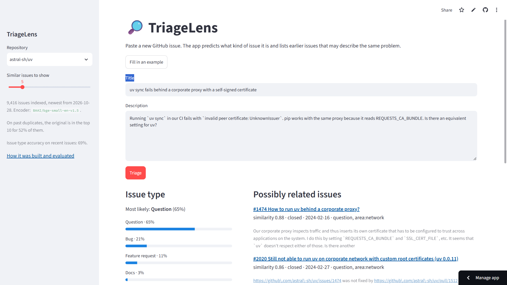

**[English Version / На английском](README.md)**

# TriageLens

[](https://www.python.org/)
[](https://streamlit.io/)
[](https://github.com/IlyaShaposhnikov/triage-lens/actions)
[](LICENSE)
[](https://triage-lens.streamlit.app/)
[](https://huggingface.co/datasets/IlyaShaposhnikov/triage-lens-demo)

Триаж GitHub issues: **что это за issue и не сообщали ли о той же проблеме раньше?**
Модели обучены и проверены на реальных issue двух популярных Python-проектов,
[astral-sh/uv](https://github.com/astral-sh/uv) и [pandas-dev/pandas](https://github.com/pandas-dev/pandas).

**[Открыть демо →](https://triage-lens.streamlit.app/)** Вставьте текст issue — демо покажет
его вероятный тип и более ранние issue, которые могут описывать ту же проблему.



## Главные выводы

- **Семантический поиск находит дубликаты намного лучше поиска по ключевым словам.** Для
  issue, который позже закрыли как дубликат, оригинал попадает в топ-10 результатов в
  **52% (uv) и 58% (pandas)** случаев с эмбеддингами `bge-small`, а у BM25 — в 27% и 33%.
- **Одно представление текста не подходит для обеих задач.** Эмбеддинги MiniLM проигрывают
  TF-IDF в определении типа issue, но в поиске дубликатов обходят поиск по ключевым словам на
  17–18 процентных пунктов (пп). Они улавливают тему issue, а не то, чего хочет автор:
  сообщить о баге или задать вопрос.
- **Кодировщик того же размера, обученный для поиска, себя оправдывает.** `bge-small`
  обходит MiniLM на тех же запросах на 7,4 пп (uv) и 7,6 пп (pandas) по recall@10, хотя на
  CPU кодирует примерно втрое медленнее.
- **С типом issue авторы в основном справляются сами — благодаря формам.** Правильную форму
  выбирают в 82% (uv) и 92% (pandas) случаев. Ни одна модель не превосходит этот показатель
  и не находит неверно поданные issue надёжно. Польза от моделей появляется там, где issue
  создан **без** формы: +42 пп (uv) и +34 пп (pandas) accuracy по сравнению с запасным вариантом.
- **Fine-tuning даёт несколько пунктов, zero-shot здесь не работает.** Дообученный DistilBERT
  показывает лучший результат среди моделей — на 2–4 пп выше TF-IDF, хотя интервалы
  перекрываются, — но ему нужен GPU. Zero-shot BART-MNLI на pandas уступает даже простому
  прогнозу самого частого класса.

## Что есть в проекте

| Шаг | Модуль | Что делает |
|---|---|---|
| Сбор | `collect.py` | Скачивает все issues через GitHub GraphQL API, умеет продолжать с места остановки и выжидать лимиты запросов |
| Пары дубликатов | `duplicates.py` | Извлекает пары «дубликат → оригинал» из комментариев и событий в истории issue |
| Ручная проверка | `review.py` | Оценивает точность этих пар на стратифицированной выборке с помощью локальной страницы для разметки |
| Датасет | `dataset.py` | Сводит метки к четырём классам, удаляет следы форм, делит данные по времени |
| Оценка | `evaluate.py` | Общие метрики с бутстрэп-интервалами и сценарий «форма + флаг» |
| Классификаторы | `baselines.py`, `embeddings.py`, `transformer.py` | Бейзлайны (самый частый класс и «доверять форме»), TF-IDF, эмбеддинги предложений, дообученный DistilBERT и zero-shot BART (на GPU в Kaggle) |
| Поиск | `search.py` | BM25, точный векторный поиск, векторная база Chroma и гибридное слияние |
| Демо | `demo_data.py`, `refresh.py`, `app_core.py`, `app/` | Публикует индекс на Hugging Face, регулярно его обновляет и показывает в Streamlit |
| Отчёт | `report.py` | Собирает таблицы результатов из `results/` |

## Данные

Issues собраны 29 октября 2026 года: **9 416** из uv и **28 656** из pandas (без pull requests).

**Метки.** Метки каждого проекта сведены к четырём классам:

| Класс | uv | pandas |
|---|---|---|
| bug | `bug` | `Bug` |
| feature | `enhancement` | `Enhancement` |
| question | `question` | `Usage Question` |
| docs | `documentation` | `Docs` |

Целевая переменная — итоговая метка, которую поставил мейнтейнер. Исключены issue без
единого из четырёх классов или с несколькими сразу, issue от ботов, а также issue pandas с
меткой `Needs Triage`: у них метка лишь повторяет значение по умолчанию из формы. Остаётся
6 412 issue в uv и 15 509 в pandas.

**Утечка меток через формы.** Оба проекта используют формы для создания issue. Форма сама
ставит метку и оставляет следы в тексте: префиксы в заголовке вроде `BUG:`, заголовки разделов,
чекбоксы, вывод версий. Модель, обученная на сыром тексте, просто считывала бы метку с шаблона.
Все такие артефакты шаблонов удаляются (функция `dataset.clean_body`), а выбранная автором форма
хранится в отдельной колонке и никогда не подаётся модели на вход.

**Разбиение по времени.** В каждом репозитории самые старые 70% issue идут в обучающую выборку,
следующие 15% — в валидационную, самые новые 15% — в тестовую. Тестовые выборки (963 issue uv с
декабря 2025 по октябрь 2026 и 2 327 issue pandas с июня 2023 по октябрь 2026) целиком приходятся
на период, когда в проектах уже были формы. Именно в таких условиях модель и применялась бы.

**Неверно поданные issue.** Среди issue, созданных через форму, итоговая метка мейнтейнера
расходится с выбранной формой у 18% issue в uv и у 8% в pandas. Чаще всего вопрос по
использованию ошибочно подают как баг (419 случаев в uv).

## Классификация типа issue

Каждая модель возвращает вероятности классов, и все они оцениваются одним и тем же кодом на
одной и той же тестовой выборке. В скобках — 95% бутстрэп-интервалы.

| Модель | uv, accuracy | pandas, accuracy | uv, macro-F1 | pandas, macro-F1 |
|---|---|---|---|---|
| Доверять форме (бейзлайн) | **77,5%** [74,9–80,1] | **91,5%** [90,3–92,6] | 0,574 | 0,786 |
| TF-IDF + логистическая регрессия | 69,0% [66,3–71,7] | 80,4% [78,7–82,0] | 0,646 | 0,660 |
| Эмбеддинги MiniLM + LogReg | 64,3% [61,2–67,3] | 62,8% [60,9–64,8] | 0,541 | 0,558 |
| Эмбеддинги MiniLM, только текст без кода | 66,4% [63,3–69,6] | 65,4% [63,6–67,4] | 0,562 | 0,566 |
| Дообученный DistilBERT | 72,6% [69,8–75,4] | 82,4% [80,9–83,9] | 0,674 | 0,681 |
| Zero-shot BART-MNLI | 46,9% [43,7–50,2] | 26,6% [24,8–28,3] | 0,508 | 0,352 |

Что видно из таблицы:

- **Accuracy и macro-F1 показывают разное.** На uv у TF-IDF macro-F1 выше, чем у бейзлайна
  «доверять форме» (0,646 против 0,574), а accuracy ниже. Всё дело в 15 issue о документации:
  в uv нет отдельной формы для документации, поэтому бейзлайн получает ноль по этому классу, а
  в macro-F1 он весит четверть. Поэтому приводятся обе метрики.
- **Форма + флаг.** Модель задумана как подсказка, а не замена: форма автора остаётся, а модель
  ставит флаг, когда уверена, что форма выбрана неверно. Порог флага подбирается на валидации
  так, чтобы верными были 50% флагов. С пользой этого не достигает ни одна модель. Лучшая
  average precision оценки флага — 0,29 на uv, при случайном угадывании — 0,16. На практике
  модели окупаются только на issue без формы, где бейзлайну остаётся угадывать самый частый класс.
- **Fine-tuning** (DistilBERT, функция потерь со взвешиванием классов, ранняя остановка по
  macro-F1 на валидации; обучение на бесплатной T4 в Kaggle заняло 11 и 16 минут) даёт самую
  сильную модель, но она всего на несколько пунктов лучше TF-IDF, который обучается за секунды
  на ноутбуке. Поэтому в демо используется TF-IDF. Ранняя остановка оказалась важна: на pandas
  лучшей была первая же эпоха.
- **Замороженные эмбеддинги предложений** проигрывают TF-IDF. У кодировщика лимит 256 токенов,
  а в форме pandas код идёт первым, поэтому до описания автора модель часто не доходит. Если
  убрать блоки кода, результат растёт на 2–3 пп, но разрыв с TF-IDF остаётся. Эти векторы
  кодируют тему, а не намерение автора.
- **Zero-shot NLI** не отличает баг от вопроса по использованию в техническом тексте.

## Поиск дубликатов

**Эталонная разметка.** GitHub не хранит надёжной связи «дубликат → оригинал». Мейнтейнеры
закрывают issue как дубликат, но оригинал указывают в комментарии в свободной форме («Duplicate
of #123», «same as …», «covered by #123»). Структурированное событие «marked as duplicate» есть
лишь у немногих issue, и его поля `canonical` и `duplicate` API возвращает перепутанными местами.
Поэтому пары извлекаются набором правил, которые применяются по порядку: событие, сильная
формулировка, слабая формулировка, единственная ссылка. Точность пар проверена вручную на 96
парах, выбранных поровну из каждого правила. Оценка точности — **93%** [76–97] для uv (430 пар)
и **99%** [81–99] для pandas (1 015 пар).

**Постановка задачи.** Каждый дубликат — это запрос ко всем issue, созданным **до** него.
Попаданием считается только сам оригинал. Пары, в которых «оригинал» новее дубликата (обсуждение
переехало в более поздний issue), исключены. Остаётся 403 запроса для uv и 958 для pandas. На
этих парах ничего не обучается и не подбирается.

| Метод | uv, recall@10 | pandas, recall@10 | uv, MRR | pandas, MRR |
|---|---|---|---|---|
| BM25 (ключевые слова) | 26,8% | 32,6% | 0,152 | 0,206 |
| MiniLM, векторный | 44,2% | 50,5% | 0,236 | 0,325 |
| **bge-small, векторный** | **51,6%** | **58,1%** | **0,304** | **0,375** |
| bge-small в Chroma (HNSW) | 51,4% | 58,1% | 0,302 | 0,376 |
| bge-small + BM25, RRF | 42,2% | 54,6% | 0,252 | 0,325 |

- Векторный поиск с bge-small обходит BM25 на 25 пп по recall@10, и парный интервал разницы
  в обоих проектах лежит намного выше нуля.
- bge-small обходит MiniLM на тех же запросах: +7,4 пп [3,0–11,9] по recall@10 на uv и
  +7,6 пп [5,0–10,3] на pandas.
- **Гибридный поиск только мешает.** Reciprocal Rank Fusion с намного более слабым BM25
  ухудшает ранжирование. Гибрид не всегда лучше.
- **Chroma возвращает те же результаты, что и точный поиск** (разница не больше 0,2 пп), и
  добавляет фильтр по времени создания и хранение на диске. В демо вместо неё используется
  точный поиск на numpy: на ~40 тысячах векторов он занимает миллисекунды, и бесплатному
  хостингу не нужен лишний сервис.

Полные таблицы, включая recall@1/5 и все интервалы, — в
[`results/summary.md`](results/summary.md).

## Инженерные заметки

Несколько проблем, найденных по ходу работы. Они собраны здесь, потому что влияли на результаты:

- **Незаметная потеря данных при пагинации через REST.** REST API GitHub отдаёт не больше
  10 000 результатов. Обходной путь с параметром `since` вместо курсора без всяких ошибок
  пропустил почти четверть issue pandas: диагностический скрипт нашёл реальные issue, которых
  не было в выгрузке. Теперь сборщик использует курсорную пагинацию GraphQL, и число issue
  совпадает с поиском GitHub.
- **Перепутанные поля** в событии GitHub «marked as duplicate» (см. выше).
- **BART и `</s>`.** В issue pandas встречается HTML-зачёркивание `<s>…</s>`. BART принимает его
  за свой служебный токен конца последовательности и отклоняет весь батч. Поэтому перед
  zero-shot классификацией строки служебных токенов удаляются.
- **Вырожденный доверительный интервал.** Доверительный интервал на основе нормального
  приближения для точности всех пар давал самому крупному правилу (10 из 10 верно) нулевую
  дисперсию и показывал 99% [98–100]. Теперь правила объединяются через апостериорные
  распределения Джеффриса, и интервал получается [81–99].
- **Результаты привязаны к своим данным.** Предсказания, сделанные в Kaggle, хранят хеш
  датасета, на котором они получены, и при несовпадении хеша оценка не запускается.

## Воспроизведение

Python 3.11+. Данные и кеши сохраняются в `data/` (папка не отслеживается в git).

`requirements.lock` фиксирует точные версии пакетов, на которых получены опубликованные
результаты. Это все группы зависимостей, кроме шага на GPU в Kaggle: там использовались
установленные в Kaggle torch 2.11 и transformers 5.16.

```bash
pip install -r requirements.lock && pip install -e . --no-deps
```

Или можно поставить актуальные версии через pip:

```bash
pip install -e ".[dev,embeddings,search]"
export GITHUB_TOKEN=...                      # fine-grained токен только на чтение

python -m triage_lens.collect astral-sh/uv pandas-dev/pandas
python -m triage_lens.duplicates astral-sh/uv pandas-dev/pandas
python -m triage_lens.dataset astral-sh/uv pandas-dev/pandas

python -m triage_lens.baselines astral-sh/uv pandas-dev/pandas
python -m triage_lens.embeddings astral-sh/uv pandas-dev/pandas [--input prose]
# fine-tuning и zero-shot: notebooks/kaggle_gpu.ipynb на GPU, затем
python -m triage_lens.predictions astral-sh/uv pandas-dev/pandas

python -m triage_lens.review sample astral-sh/uv pandas-dev/pandas   # затем разметить пары
python -m triage_lens.review score annotations/duplicate_verdicts.json
python -m triage_lens.search astral-sh/uv pandas-dev/pandas --model BAAI/bge-small-en-v1.5

python -m triage_lens.report --out results/summary.md
```

Запуск демо локально:

```bash
pip install -r requirements.txt
streamlit run app/streamlit_app.py
```

Опубликованный индекс раз в неделю обновляет workflow
([`refresh.yml`](.github/workflows/refresh.yml)). Он скачивает датасет с Hugging Face,
догружает issue, созданные или изменённые с прошлого запуска, и заново кодирует только те, у
которых изменился текст. Затем проверяет, что индекс загружается и отвечает на запрос, и
публикует его. Приложение подхватывает обновление в течение шести часов. Классификатор не
переобучается: его оценка привязана к фиксированному разбиению по времени. Обновление можно
запустить и вручную (без `--push` это пробный запуск без публикации):

```bash
python -m triage_lens.refresh --repo-id USER/triage-lens-demo [--push]
```

Для workflow нужен секрет репозитория `HF_TOKEN` с правом записи в датасет. Если в репозитории
60 дней нет коммитов, GitHub отключает запуски по расписанию. Снова включить их или запустить
workflow вручную можно на вкладке Actions.

Тесты: `pytest`, больше 140 тестов, и ни одному не нужны сеть или GPU: GitHub API, модели
эмбеддингов, Chroma и Hugging Face Hub в них заменены заглушками. CI запускает линтер и тесты
на Python 3.11 и 3.12.

## Ограничения

- Всего два проекта, оба — Python-библиотеки с активными мейнтейнерами и формами для issue.
  В проектах с другими привычками разметки цифры будут другими.
- Метки классов — итоговые метки мейнтейнеров, и они тоже не идеальны. Вопросов в pandas за
  тестовый период мало (73 issue), так что цифры по этому классу шумные.
- Эталон покрывает только те дубликаты, которые мейнтейнеры заметили и связали с оригиналом.
  «Промах» поиска может оказаться верным совпадением, которое просто никто не отметил.
- Индекс демо обновляется каждую неделю, но классификатор обучен на issue до октября 2026 года
  и не переобучается, поэтому на новых issue его точность может постепенно меняться.

## Автор

Илья Шапошников | [E-mail](mailto:ilia.a.shaposhnikov@gmail.com) | [LinkedIn](https://linkedin.com/in/iliashaposhnikov)

Код распространяется под [лицензией MIT](LICENSE). Данные — публичные issue
[astral-sh/uv](https://github.com/astral-sh/uv) и [pandas-dev/pandas](https://github.com/pandas-dev/pandas),
полученные через [GitHub API](https://docs.github.com/en/graphql). Тексты issue принадлежат их
авторам; опубликованный датасет содержит только короткие фрагменты для поиска.

**[English Version / На английском](README.md)**
